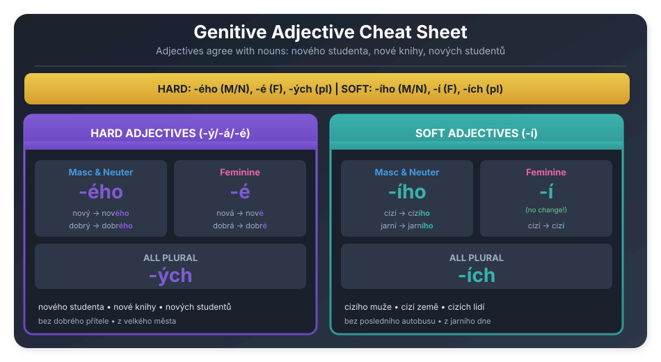

# Genitive Adjective Cheatsheet

All adjective endings at a glance.

---

## Visual Cheatsheet



---

## The Key Pattern

:::tip Genitive Adjectives
- **Hard adjectives**: -ého (masc/neut), -é (fem)
- **Soft adjectives**: -ího (masc/neut), -í (fem)
- **Plural (all)**: -ých (hard), -ích (soft)
:::

---

## Quick Reference Tables

### Hard Adjectives (nový, starý, dobrý...)

| | Nominative | Genitive | Example |
|:--|:-----------|:---------|:--------|
| **Masc. Sg.** | nov**ý** | nov**ého** | nového studenta |
| **Fem. Sg.** | nov**á** | nov**é** | nové knihy |
| **Neut. Sg.** | nov**é** | nov**ého** | nového města |
| **All Plural** | noví/é/á | nov**ých** | nových studentů |

### Soft Adjectives (cizí, jarní, poslední...)

| | Nominative | Genitive | Example |
|:--|:-----------|:---------|:--------|
| **Masc. Sg.** | ciz**í** | ciz**ího** | cizího muže |
| **Fem. Sg.** | ciz**í** | ciz**í** | cizí země |
| **Neut. Sg.** | ciz**í** | ciz**ího** | cizího města |
| **All Plural** | ciz**í** | ciz**ích** | cizích lidí |

---

## Memory Trick

```
┌─────────────────────────────────────────────┐
│           GENITIVE ADJECTIVES               │
├─────────────────────────────────────────────┤
│                                             │
│   HARD (-ý/-á/-é)                           │
│   ─────────────                             │
│   Masc./Neut.: -ÉHO                         │
│   Feminine:    -É                           │
│   Plural:      -ÝCH                         │
│                                             │
│   SOFT (-í)                                 │
│   ─────────                                 │
│   Masc./Neut.: -ÍHO                         │
│   Feminine:    -Í (no change!)              │
│   Plural:      -ÍCH                         │
│                                             │
└─────────────────────────────────────────────┘
```

---

## Possessives

| Possessive | Masc./Neut. Gen. | Fem. Gen. |
|:-----------|:-----------------|:----------|
| můj | **mého** | **mé** |
| tvůj | **tvého** | **tvé** |
| jeho | jeho | jeho |
| její | **jejího** | **její** |
| náš | **našeho** | **naší** |
| váš | **vašeho** | **vaší** |
| jejich | jejich | jejich |

---

## Demonstratives

| | Masc./Neut. Gen. | Fem. Gen. | Plural Gen. |
|:--|:-----------------|:----------|:------------|
| ten/ta/to | **toho** | **té** | **těch** |
| tento/tato/toto | **tohoto** | **této** | **těchto** |

---

## Interrogatives (Který/Jaký)

| | Masc./Neut. | Feminine | Plural |
|:--|:-----------|:---------|:-------|
| který | **kterého** | **které** | **kterých** |
| jaký | **jakého** | **jaké** | **jakých** |

---

## Common Examples

| Type | Nominative | Genitive | English |
|:-----|:-----------|:---------|:--------|
| Hard M | nový student | nového studenta | of a new student |
| Hard F | dobrá kniha | dobré knihy | of a good book |
| Hard N | velké město | velkého města | of a big city |
| Soft M | cizí muž | cizího muže | of a foreign man |
| Soft F | cizí země | cizí země | of a foreign country |
| Poss. | můj bratr | mého bratra | of my brother |
| Dem. | ta žena | té ženy | of that woman |
| Plural | noví studenti | nových studentů | of new students |

---

## With Prepositions

| Czech | English |
|:------|:--------|
| bez **dobrého** přítele | without a good friend |
| z **velkého** města | from a big city |
| do **nové** školy | to a new school |
| u **starého** doktora | at the old doctor's |
| pět **mladých** studentů | five young students |

---

## Summary

| | Masc. Sg. | Fem. Sg. | Neut. Sg. | All Plural |
|:--|:----------|:---------|:----------|:-----------|
| **Hard** | -ého | -é | -ého | -ých |
| **Soft** | -ího | -í | -ího | -ích |

**Memory trick**: Hard → É family (-ého, -é, -ých). Soft → Í family (-ího, -í, -ích).

---

*Print this page: Ctrl+P (Cmd+P on Mac)*
