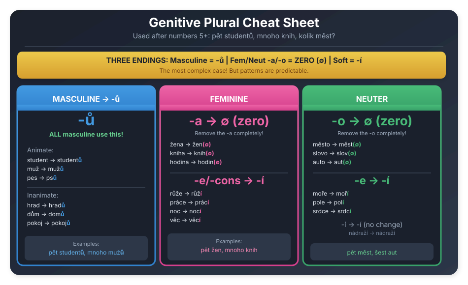

# Genitive Plural Cheatsheet

The genitive plural is the **most complex** part of Czech declension!

---

## Visual Cheatsheet

---

## At a Glance

| Type | Nom. Singular | Gen. Plural | Example |
|:-----|:--------------|:------------|:--------|
| **Masc. all** | student | student**ů** | pět studentů |
| **Feminine -a** | žena | žen (∅) | pět žen |
| **Feminine -e** | růže | růž**í** | pět růží |
| **Feminine cons.** | věc | věc**í** | pět věcí |
| **Neuter -o** | město | měst (∅) | pět měst |
| **Neuter -e** | moře | moř**í** | pět moří |
| **Neuter -í** | nádraží | nádraží | pět nádraží |

---

## Masculine → Always **-ů**

Good news! All masculine nouns use **-ů** in genitive plural.

### Animate Hard

| Nom. Sg. | Gen. Pl. | Example |
|:---------|:---------|:--------|
| student | student**ů** | pět studentů |
| bratr | bratr**ů** | pět bratrů |
| pes | ps**ů** | pět psů |
| pán | pán**ů** | pět pánů |

### Animate Soft

| Nom. Sg. | Gen. Pl. | Example |
|:---------|:---------|:--------|
| muž | muž**ů** | pět mužů |
| učitel | učitel**ů** | pět učitelů |
| prodavač | prodavač**ů** | pět prodavačů |

### Inanimate

| Nom. Sg. | Gen. Pl. | Example |
|:---------|:---------|:--------|
| hrad | hrad**ů** | pět hradů |
| dům | dom**ů** | pět domů |
| stroj | stroj**ů** | pět strojů |
| pokoj | pokoj**ů** | pět pokojů |

---

## Feminine -a → **Zero Ending** (∅)

The **-a** disappears! Sometimes a vowel is inserted to help pronunciation.

### Standard Pattern (just remove -a)

| Nom. Sg. | Gen. Pl. | Example |
|:---------|:---------|:--------|
| žena | žen | pět žen |
| kniha | knih | pět knih |
| škola | škol | pět škol |
| hodina | hodin | pět hodin |
| koruna | korun | pět korun |

### With Inserted Vowel

| Nom. Sg. | Gen. Pl. | Example |
|:---------|:---------|:--------|
| sestra | sester | pět sester |
| hra | her | pět her |

---

## Feminine -e → **-í**

| Nom. Sg. | Gen. Pl. | Example |
|:---------|:---------|:--------|
| růže | růž**í** | pět růží |
| ulice | ulic | pět ulic |
| restaurace | restaurac**í** | pět restaurací |
| práce | prác**í** | pět prací |

---

## Feminine Consonant → **-í**

| Nom. Sg. | Gen. Pl. | Example |
|:---------|:---------|:--------|
| věc | věc**í** | pět věcí |
| noc | noc**í** | pět nocí |
| kost | kost**í** | pět kostí |
| postel | postel**í** | pět postelí |

---

## Neuter -o → **Zero Ending** (∅)

Like feminine -a, the ending disappears.

### Standard Pattern

| Nom. Sg. | Gen. Pl. | Example |
|:---------|:---------|:--------|
| město | měst | pět měst |
| slovo | slov | pět slov |
| místo | míst | pět míst |
| pivo | piv | pět piv |
| auto | aut | pět aut |

### With Inserted Vowel

| Nom. Sg. | Gen. Pl. | Example |
|:---------|:---------|:--------|
| jablko | jablek | pět jablek |
| okno | oken | pět oken |

---

## Neuter -e/-í → **-í** or no change

| Nom. Sg. | Gen. Pl. | Example |
|:---------|:---------|:--------|
| moře | moř**í** | pět moří |
| pole | pol**í** | pět polí |
| srdce | srdc**í** | pět srdcí |
| nádraží | nádraží | pět nádraží |
| náměstí | náměstí | pět náměstí |

---

## Summary Table

| Ending | Used For | Examples |
|:-------|:---------|:---------|
| **-ů** | All masculine | studentů, mužů, domů |
| **∅ (zero)** | Fem. -a, Neut. -o | žen, knih, měst, slov |
| **-í** | Fem. -e, Fem. cons., Neut. -e | růží, nocí, moří |

---

## Memory Tricks

:::tip Patterns to Remember
1. **Masculine** → always **-ů** (easy!)
2. **Feminine -a** → lose the -a (žena → žen)
3. **Feminine -e** → change to **-í** (růže → růží)
4. **Neuter -o** → lose the -o (město → měst)
5. **Soft endings** → usually **-í**
:::

---

*Print this page: Ctrl+P (Cmd+P on Mac)*
