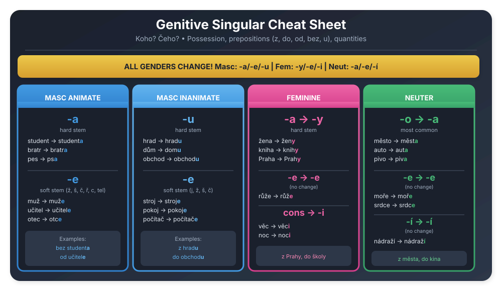

# Genitive Singular Cheatsheet

---

## Visual Cheatsheet

---

## At a Glance

| Type | Nominative | Genitive | Example |
|:-----|:-----------|:---------|:--------|
| **Masc. Animate Hard** | student | student**a** | bez studenta |
| **Masc. Animate Soft** | muž | muž**e** | bez muže |
| **Masc. Inanimate Hard** | hrad | hrad**u** | z hradu |
| **Masc. Inanimate Soft** | stroj | stroj**e** | ze stroje |
| **Feminine -a** | žena | žen**y** | bez ženy |
| **Feminine -e** | růže | růž**e** | bez růže |
| **Feminine cons.** | věc | věc**i** | bez věci |
| **Neuter -o** | město | měst**a** | z města |
| **Neuter -e** | moře | moř**e** | z moře |
| **Neuter -í** | nádraží | nádraž**í** | z nádraží |

---

## Masculine Animate

### Hard Consonants → add **-a**

| Nom. | Gen. | Example |
|:-----|:-----|:--------|
| student | student**a** | bez studenta |
| pes | ps**a** | bez psa |
| bratr | bratr**a** | od bratra |
| Petr | Petr**a** | od Petra |
| doktor | doktor**a** | u doktora |

### Soft Consonants → add **-e**

| Nom. | Gen. | Example |
|:-----|:-----|:--------|
| muž | muž**e** | bez muže |
| učitel | učitel**e** | od učitele |
| otec | otc**e** | od otce |

---

## Masculine Inanimate

### Hard Consonants → add **-u**

| Nom. | Gen. | Example |
|:-----|:-----|:--------|
| hrad | hrad**u** | z hradu |
| dům | dom**u** | z domu |
| stůl | stol**u** | u stolu |
| obchod | obchod**u** | do obchodu |
| film | film**u** | konec filmu |

### Soft Consonants → add **-e**

| Nom. | Gen. | Example |
|:-----|:-----|:--------|
| stroj | stroj**e** | ze stroje |
| pokoj | pokoj**e** | z pokoje |
| počítač | počítač**e** | u počítače |

---

## Feminine

### -a Nouns → **-y**

| Nom. | Gen. | Example |
|:-----|:-----|:--------|
| žena | žen**y** | bez ženy |
| kniha | knih**y** | autor knihy |
| škola | škol**y** | do školy |
| Praha | Prah**y** | z Prahy |

### -e Nouns → **-e** (no change)

| Nom. | Gen. | Example |
|:-----|:-----|:--------|
| růže | růž**e** | bez růže |
| restaurace | restaurac**e** | vedle restaurace |
| práce | prác**e** | do práce |

### Consonant Nouns → **-i**

| Nom. | Gen. | Example |
|:-----|:-----|:--------|
| věc | věc**i** | bez věci |
| noc | noc**i** | uprostřed noci |
| kost | kost**i** | bez kosti |

---

## Neuter

### -o Nouns → **-a**

| Nom. | Gen. | Example |
|:-----|:-----|:--------|
| město | měst**a** | z města |
| auto | aut**a** | barva auta |
| pivo | piv**a** | sklenice piva |
| okno | okn**a** | z okna |

### -e Nouns → **-e** (no change)

| Nom. | Gen. | Example |
|:-----|:-----|:--------|
| moře | moř**e** | blízko moře |
| srdce | srdc**e** | z celého srdce |
| pole | pol**e** | uprostřed pole |

### -í Nouns → **-í** (no change)

| Nom. | Gen. | Example |
|:-----|:-----|:--------|
| nádraží | nádraž**í** | z nádraží |
| náměstí | náměst**í** | uprostřed náměstí |

---

## Summary by Ending

| Gender/Type | Ending |
|:------------|:-------|
| Masc. Animate Hard | **-a** |
| Masc. Animate Soft | **-e** |
| Masc. Inanimate Hard | **-u** |
| Masc. Inanimate Soft | **-e** |
| Feminine -a | **-y** |
| Feminine -e | **-e** |
| Feminine cons. | **-i** |
| Neuter -o | **-a** |
| Neuter -e | **-e** |
| Neuter -í | **-í** |

---

*Print this page: Ctrl+P (Cmd+P on Mac)*
